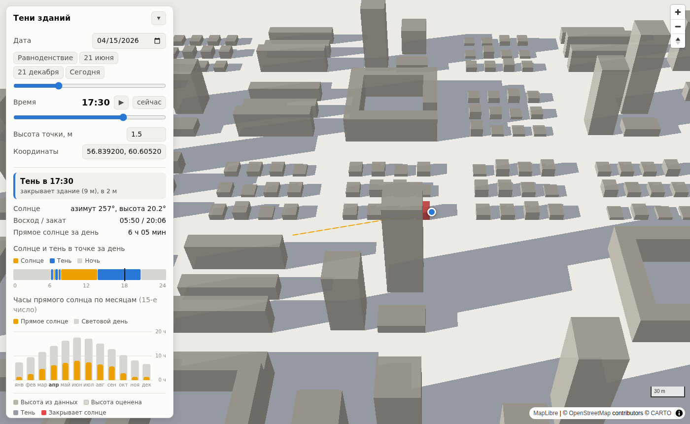

# building-shadows

MVP карты теней от зданий. Ставите точку на карте, выбираете дату и время и видите:

- тени всех зданий в окне карты для выбранного момента (3D-здания на MapLibre);
- что сейчас в точке: солнце, тень (и какое здание закрывает солнце) или ночь;
- таймлайн дня для точки: когда там солнце, а когда тень, и сколько всего часов прямого солнца;
- часы прямого солнца по месяцам (на 15-е число каждого месяца);
- расчёт на любой высоте над землёй: например, окно 5-го этажа ≈ 13 м.

Постановка и обзор источников данных лежат в [`docs/spec.md`](docs/spec.md).



## Запуск

```bash
python -m venv .venv && source .venv/bin/activate
pip install -r requirements.txt
python -m shadows            # здания из OpenStreetMap (Overpass API)
# открыть http://127.0.0.1:8000/
```

Другие режимы:

```bash
python -m shadows --demo                      # синтетический квартал, без сети
python -m shadows --file ekb_buildings.geojson  # свой GeoJSON, например Overture Maps
```

Здания Overture для Екатеринбурга (см. `docs/spec.md`):

```bash
pip install overturemaps
overturemaps download --bbox=60.45,56.70,60.80,56.95 -f geojson --type=building -o ekb_buildings.geojson
python -m shadows --file ekb_buildings.geojson
```

Тесты:

```bash
pip install -r requirements-dev.txt
pytest
```

## Как пользоваться

- **Клик по карте** или перетаскивание метки переносит точку.
- **Дата**: календарь, ползунок дня года или кнопки «Равноденствие», «21 июня», «21 декабря».
- **Время**: ползунок, кнопка ▶ (проигрывает день) или клик и протяжка по таймлайну.
- **Высота точки**: на какой высоте над землёй проверяется солнце.
- Наведите курсор на здание, чтобы увидеть его высоту и откуда она взята. Бледные здания — высота оценена по умолчанию.
- Состояние (точка, дата, время) хранится в URL, ссылку можно отправить.

## Устройство

```
shadows/
  solar.py      положение солнца (алгоритм NOAA), восход, закат, полдень
  buildings.py  здания: оценка высоты, источники OSM/Overpass (с кэшем по тайлам), GeoJSON, демо
  engine.py     тени-полигоны (сумма Минковского) и проверка точки лучом к солнцу
  api.py        FastAPI: /api/buildings, /api/sun/day, /api/point, /api/point/year, /api/shadows, /api/sun
  static/       фронтенд без сборки: MapLibre GL, shadow-layer.js — WebGL-слой теней
tests/          pytest
```

**Тень здания.** Здание — вертикальная призма от `min_height` до `height`. Её тень на земле — основание, сдвинутое вдоль вектора от солнца на все высоты от `min_height` до `height`. Для выпуклых оснований это выпуклая оболочка двух сдвинутых копий, для остальных (дворы, Г-образные здания) к ним добавляются полосы, которые заметают рёбра. Тени всех зданий объединяются одним `union_all`.

**Гибрид: карта на клиенте, аналитика на сервере.**
- Тени на карте рисует браузер (`static/shadow-layer.js`, собственный WebGL-слой MapLibre). Алгоритм тот же, что в `engine.py`. Геометрия загружается в видеокарту один раз при загрузке зданий. При смене времени меняется только вектор тени, это uniform шейдера, поэтому слайдер и анимация работают мгновенно, без запросов к серверу.
- Чтобы наложения теней не темнели, тени рисуются в отдельный framebuffer (маска), а маска одним проходом накладывается на карту. Объединять полигоны (`union_all`) не нужно.
- Положение солнца браузер не считает. Он один раз на дату получает с сервера таблицу на весь день с шагом 5 минут (`/api/sun/day`), поэтому формула солнца есть только в Python.
- Анализ точки (таймлайн, часы солнца по месяцам) считается на сервере тем же алгоритмом. Туда же потом добавятся рельеф и деревья.
- `/api/shadows` остаётся для выгрузки теней в GeoJSON и для сверки: GPU-маска совпадает с серверными полигонами.

**Точка.** Из точки (на заданной высоте) пускается луч к солнцу. Солнце закрыто, если на участке, где луч проходит над основанием здания, его высота попадает в интервал `[min_height, height]` этого здания. Тест проверяет, что этот расчёт совпадает с полигонами теней.

**Высота зданий.** Берётся `height`, если его нет, то `building:levels` × 3 м (для Overture `num_floors`), если нет и этажности — значение по умолчанию по типу здания (гараж 3 м, дом 7 м, иначе 9 м).

### API

| Запрос | Что возвращает |
|---|---|
| `GET /api/buildings?bbox=w,s,e,n` | GeoJSON зданий с `height`, `min_height`, `height_source` |
| `GET /api/sun/day?lat&lon&date&step=5` | азимут и высота солнца на весь день (для отрисовки теней в браузере) |
| `GET /api/shadows?bbox=…&date=YYYY-MM-DD&time=HH:MM` | GeoJSON теней и положение солнца (для выгрузки) |
| `GET /api/point?lat&lon&date&time&height=1.5&step=5` | состояние в точке, здание-блокер, таймлайн дня, минуты солнца |
| `GET /api/point/year?lat&lon&year&height` | минуты прямого солнца и светового дня по месяцам |
| `GET /api/sun?lat&lon&date&time` | азимут и высота солнца, восход, закат |

Время везде **местное** для точки: часовой пояс определяется по координатам (`timezonefinder`), его можно задать параметром `tz=Europe/Moscow`.

Настройки через переменные окружения: `SHADOWS_SOURCE` (`auto`/`osm`/`file`/`demo`), `SHADOWS_BUILDINGS_FILE`, `SHADOWS_CACHE_DIR` (по умолчанию `data/cache`), `SHADOWS_OVERPASS_URL` (адреса через запятую).

## Ограничения MVP и что дальше

- Земля плоская: рельеф не учитывается. Следующий шаг — горизонт по AWS Terrain Tiles.
- Деревья не учитываются. Можно добавить слой Meta Canopy Height (см. спеку).
- Тени падают только на землю, на крыши соседних зданий не ложатся. Форма крыш не учитывается.
- Тени длиннее 800 м обрезаются. Здания дальше 400 м за краем экрана свою тень в окно не отбрасывают.
- `building:part` из OSM пока не используется, берётся контур здания с общей высотой.
- Серверный `/api/shadows` на 3000 зданий работает около 0,5 с. Для карты он не используется, но для массовой выгрузки может понадобиться кэш.
- Для теней на карте нужен браузер с WebGL.

## Данные и лицензии

- Здания © участники OpenStreetMap, [ODbL](https://www.openstreetmap.org/copyright). Подложка © CARTO.
- Картинки теней — производная работа (Produced Work), для них достаточно указать авторство OSM. Если распространять саму базу зданий с дополненными высотами, она тоже должна быть под ODbL.
